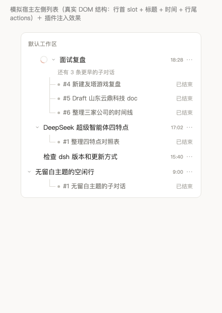
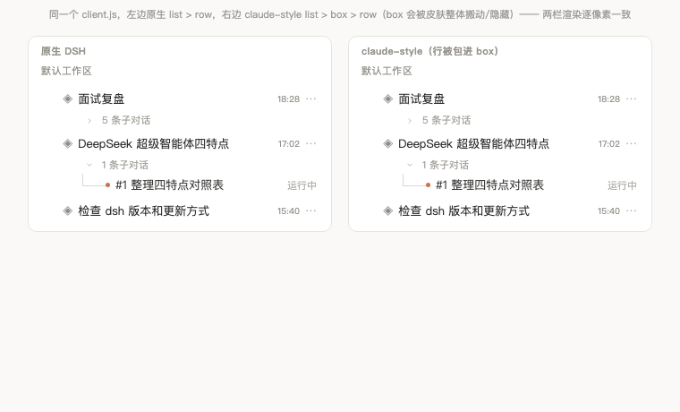

# dsh-subagent-tree

在 DSH 的左侧会话列表里，把**子代理会话**画成主会话的**缩进子树**：连接线、编号 + 摘要、运行状态。

- 对**任意 agent 模式**生效：标准模式派的子代理、本插件自带的「Router 项目经理模式」派的子代理、你自己写的 preset 派的子代理，只要有父子关系就会出现在树里。
- 对**主题免疫**：只用宿主的业务属性 `[data-row-key^="session:"]` 作锚点，颜色全部取自 `--dsw-alias-*` 语义变量，claude style、默认皮肤、以后的新主题都不会让它错位或变黑。
- 不修改宿主源码，不替换任何宿主槽位，卸载即恢复原样。

---

## 它解决什么问题

DSH 标准的会话列表是**平铺**的：主会话和子代理会话混在一起，而宿主又刻意把 `origin === 'subagent'` 的会话从列表里隐藏掉（`sessionVisible()` 对子代理返回 false）。结果是：

- 你看不到主对话底下到底派了几个子代理；
- 想知道某个子代理干到哪一步，只能去右侧任务管理面板一个个点开；
- 视图一关，子代理的痕迹就从左侧消失了。

装上本插件后，主会话那一行下面会多出它的子会话，缩进一级、用连接线连起来，每行带「运行中 / 已结束」和一句摘要，点一下就能打开它的过程记录。

## 长什么样

展开：

```
▾ ◈ 面试复盘                            2026-11-07   18:28
    ├ ● #1 山东云鼎问题书面化                        运行中
    ├ ● #2 途虎养车问题书面化                        已结束
    └ ● #3 Draft 山东云鼎科技 doc                    已结束
▾ ◈ DeepSeek 超级智能体四特点与实现                2026-11-07   17:02
    └ ● #1 整理四特点对照表                          运行中
```

子对话很多时，默认只画最近 3 条，更早的折成一行提示（再点一次就全展开）：

```
▾ ◈ 面试复盘                            2026-11-08   18:28
      还有 3 条更早的子对话
    ├ ● #4 新建友塔游戏复盘                          已结束
    ├ ● #5 Draft 山东云鼎科技 doc                    已结束
    └ ● #6 整理三家公司的时间线                      已结束
```

收起（只留主对话在外边）：

```
▸ ◈ 面试复盘                            2026-11-07   18:28
```

渲染截图（在模拟宿主 DOM 的验证页里跑真实 `lib/client.js`）：

| 展开 | 收起 |
|---|---|
|  |  |

- **▾ / ▸** 是主行**行首左侧**的收起箭头 —— 位置是量出来的：脚本会找主行里真正显示标题的那个节点，把箭头贴到它左侧 18px，所以箭头和标题之间没有空隙，也不会挤动宿主的标题（`position: absolute`，不占布局）。不放行尾，因为行尾操作区常要 hover 才显形，等于藏起来。
- 每个主行单独收起 / 展开（状态记在 localStorage，重开应用还在）；子对话超过 3 条时只显示最近的，更早的折成「还有 N 条更早的子对话」。
- **#1 / #2** 是编号，按子会话创建时间排。
- 标题优先取宿主派单时写下的短名（`subagentCatalog[].label`，也就是主智能体给这次派活起的名字，如「山东云鼎问题书面化」），拿不到才退回会话标题，再拿不到才用会话 id 前 8 位。
- 子行从连接线开始缩进：引导线在 48px、文字在 64px。
- **●** 的颜色表示状态：运行中是品牌色，已结束是中性色。
- 连接线用 `currentColor` 的淡色版本，所以任何主题下都协调。

## 安装

```bash
dsh plugin --profile <你的 profile> add /path/to/dsh-subagent-tree
```

或者在这个仓库里已经装好的 DSH 里，用插件管理器安装这个目录（`install_bundle`），装完**完全退出并重开** DSH NEXT。

## 配置

没有必须配的项。两个开关在实现里已经做成默认值：

| 行为 | 默认 | 存在哪 |
|---|---|---|
| 默认展开还是收起 | 展开 | `localStorage["dsh-subagent-tree:collapsed"]`，只记被收起的主会话 |
| 摘要截断长度 | 40 字 | 源码 `clip(raw, 40)` |
| 是否显示侧边对话（`Side: ` 开头） | 不显示 | `childrenOf()` 里的过滤——那不是 agent 派的活 |

调度层（0.2.0 起的 Router 模式）还有两个可选配置，写在 profile 的 `cordis.patch.yml` 里那行 `config` 下：

| 配置 | 默认 | 说明 |
|---|---|---|
| `runtime` | `true` | 设成 `false` 就完全不装工单表 —— `ticket_create` 退回「直接派发」，不排队、不持久化、不回收重启残留，也不跑 Watchdog |
| `stateDir` | `$DSH_HOME/state/router-worker` | 换 sqlite 落地目录。`$DSH_HOME` 没设时是 `~/.dsh` |

Watchdog 不需要单独配置：它随 `runtime` 一起启停，阈值（60 秒巡检 / 15 分钟静默 / 30 分钟排队提醒）写在 `lib/watchdog.js` 顶部的常量里。

## 它怎么拿到数据的

只用宿主已有的两个事实，不额外开服务：

1. **父子关系** —— `ctx.sessions.list.getSnapshot().byId` 里每个会话摘要都带 `origin: 'subagent'` 和 `parentId`。这是宿主的持久字段，与哪个插件派的活无关，所以本插件对 Multitask **零依赖**。
2. **短名** —— 同一份快照里的 `projectionsBySession[parentId].values.subagentCatalog[].label`，就是主智能体派单时写下的那行短描述（`subagent` 工具的 `description` 参数）。没有它才退回 `displayTitle`。
3. **运行状态** —— 同一份摘要上的 `running`；有 `useSessionStatus` 时以它为准。更细的过程文本走宿主的 `subagents.live` 路由（右侧任务管理面板用的就是它）。

## 它怎么打开子对话

按优先级三级降级：

1. 宿主右侧的 `subagentchat` 标签页（`sidebarRight.openResource(address, {kind:'subagentchat'})`，地址形如 `dsh-resource://subagentchat/session/<child>?parent=<parent>&mode=<mode>`）——**不离开当前主对话**就能看子代理过程；
2. `uiWorkspace.openSession(childId)`——普通会话跳转；
3. `sessions.open(childId)`——最老的 API 形状。

宿主版本更新导致某一级失效时，会自动往下一级走，不会白屏。

## 已知边界

- **不是原生行**。宿主把整个左侧浏览区声明成 single 独占插槽（`sidebar.workspaces`，`replaceRisk: shadows-shipped-ui`），插件的 slots 挂不进去，所以本插件用 DOM 注入实现。代价是：子行**没有**置顶 / 重命名 / 归档 / 拖拽排序这些原生行才有的右键菜单能力，点击是「打开」，不是「选中」。
- **宿主重画会重建 DOM**。插件用 MutationObserver 跟进，并且**画之前先断开观察器**，否则会自己触发自己形成死循环。极端情况下（宿主在同一个微任务里连续重建两次）可能抖动一帧。
- **侧边对话不进来**。`Side: ` 开头的是宿主自己的「侧边对话」功能，语义上不是子代理，故意排除。
- **嵌套只画一层**。DSH 的委派深度默认是 1（worker 不能再派），所以一层就够用；真出现孙会话时，它会在自己的父行下被单独渲染。

## 卸载

```bash
dsh plugin --profile <profile> remove dsh-subagent-tree
```

卸载时 `install()` 返回的清理函数会移除样式表、所有子行和箭头，宿主列表恢复原样。

## 许可

MIT

---

## 与「模式」（agent preset）的关系

本插件从 0.2.0 起**自带一个模式**：「Router 项目经理模式」（preset id `router-worker`），装一次就有了。它从 `dsh-multitask` 1.3.3 分叉而来，保留上游的协调者窄工具面、四类 worker、两级审批闸门与 Windows 工作区 ACL 修复，并在这个基础上加了工单语义：

- **主对话只派单，不干活**：它的工具面被刻意收窄（没有 shell、不能写文件），所以它只能把活开成工单派出去。
- **每张工单必须有短名**：`ticket_create` 的 `title` 是必填参数（2–40 字），原样写进宿主记录的 `subagentCatalog.label` —— 也就是本插件侧栏树上显示的那一行。
- **工单会排队、会记住**：工单落在 `$DSH_HOME/state/router-worker/tickets.db`（sqlite）。宿主名额满了不会把工单判死，只留在队列里等 —— 宿主自己的原文是「Admission does not queue」，排队这件事得由我们做。重启后正在跑的工单会去查子会话还在不在：还在就接着等，没了就标失败并补一条通知，不会让你对着一个永远「运行中」的行发呆。
- **结果回流**：worker 干完把结论交回主对话，主对话只保留结论，不保留过程。宿主自己会发一条完成通知；本插件额外的一张 outbox 表补的是它补不了的两种情况 —— 进程重启后、以及父会话当时不在回合中。投递失败会退避重试（1 秒 → 5 秒 → 30 秒 → 5 分钟），10 次投不出去才放弃并告警。
- **卡死自动收尾（Watchdog）**：还有第三类异常 —— worker 没崩、没发 `turn/end`、却也不再产出（网络挂起、模型卡死、工具僵住）。watchdog 每 60 秒巡检，某张 `running` 工单静默超过 15 分钟就中断它的子会话、标 `failed` 并通知主对话，把占住的并发名额还回去；`queued` 超 30 分钟只提醒一次，不改状态。心跳取 `session/event`（不是 `updated_at`），所以正在流式输出、连续调工具的 worker 不会被误杀；刚重启恢复的工单会先给一个完整宽限期。刻意**不用 LLM 判断跑偏**，只做「静默超时」这一条机械判据。

> 工单表是**可选**的：`node:sqlite` 打不开时自动降级成内存表并告警 —— 功能全在，只是重启即失忆。想让工单落地，把 `runtime` 保持默认（见下面的配置表）。

这个模式与侧栏树是**同一个包里的两件事**，互相不依赖：树只读宿主的父子关系（`origin: 'subagent'` + `parentId`），所以它照常会显示**任何**模式派出的子代理，包括标准模式、别的插件模式、你自己写的 preset。

三种组合方式：

| 做法 | 说明 | 代价 |
|---|---|---|
| 用自带的 Router 模式（推荐） | 新建会话时选「Router 项目经理模式」，装一次就同时得到派单能力与侧栏树 | 该模式刻意收窄主对话工具面，不适合想让主对话亲自写代码的场景 |
| 用别的派单模式 | 例如另外装 `dsh-multitask` 选「Multitask 减震器模式」；本插件照样把它的子代理画成树 | 两个插件，各自独立升级 |
| 在别的模式里写进提示词 | 自己的 preset 里加一句「遇到可并行的子任务就派子代理，派单时写好 `description`」 | 只是提示词，模型可以不照做 |

第三种里的 `description`（`subagent` 等委派工具的可选参数，3–5 个词）就是侧栏那一行短名。自带的 Router 模式用 `ticket_create` 把这件事变成**必填**，所以那边不需要靠提示词自觉。

